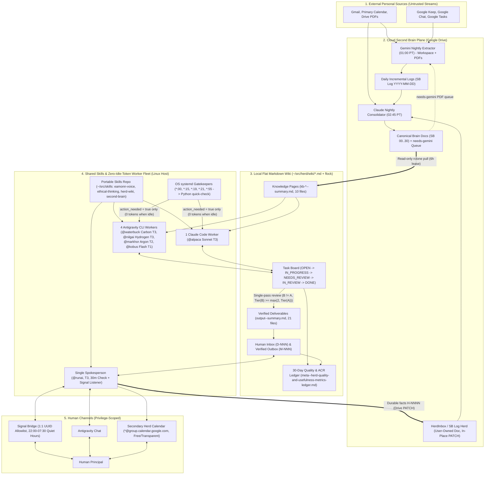

# Second Brain and Herd: Architecture, Verification, and Token Costs of a Personal Multi-Agent System

2026-11-15

## Abstract

I wanted an AI assistant that could keep track of my personal email, calendars, and documents while also doing real work in local git repositories, without giving a shell-enabled agent direct access to Gmail or splitting my attention across a dozen chat threads.

This report describes the two-part system I built on Linux to try that out, combining a nightly cloud memory consolidator (*Second Brain*) with an asynchronous local multi-agent ensemble (*Herd*). Tier 1 uses scheduled cloud jobs in Gemini and Claude to distill Google Workspace streams and PDF attachments into versioned, source-tagged Markdown files in Google Drive. Tier 2 runs local Gemini and Claude worker agents that pull those files across a read-only boundary, coordinate through a flat directory of summary-named Markdown files (57 files, 489 KB), check one another's work under a capability-tiered maker-checker protocol, and share portable skills for ethical analysis (`ethical-thinking`) and personal writing style (`eamonn-voice`). A single spokesperson agent (`@runai`) handles all conversation with me across chat, an allowlisted Signal bridge, and a secondary Google Calendar.

Across the first 39.7 hours of operation (2,259 planner steps, 42 tasks, and 21 deliverables), the system caught an un-calendared contractor visit, extracted liability and reserve risks from a 60-page housing co-op budget, and pushed three tested bug-fix branches. However, its token logs also exposed a 57.6M token/day idle prefill waste caused by hourly in-session crons missing the provider KV-cache window. Moving worker polling into zero-idle-token OS `systemd` gatekeepers eliminated that idle cost, and a 30-day telemetry ledger now tracks whether the system earns its keep over time.

## Design

Most personal AI setups fail in one of two ways.

Cloud assistants wired into Gmail, Calendar, and Drive can read personal context, but they lose state across weeks and cannot run local tests or daemons. They also differ awkwardly in what their connectors can read, given that Gemini reads Google Keep, Chat, Tasks, and Drive PDFs natively whereas Claude cannot open binary Drive PDFs from its connector.

On the other hand, giving a local shell agent direct access to raw email, private files, and outbound network tools combines all three parts of Simon Willison's "lethal trifecta" (untrusted input, private data, and external action), which means a prompt injection hidden in an incoming email could run shell commands or exfiltrate secrets.

Running several local agents creates three more practical problems. First, $N$ agents normally mean $N$ chat threads to babysit. Second, mixing fast, cheap models with slower reasoning models produces uneven output quality.

Third, any draft an agent writes for external readers under my name (an email reply, a LinkedIn post, or a design memo) is worse than useless if it reads like machine-generated prose. I work on AI trust, privacy, and user controls, and I write about those topics in public, so machine-made text under my name costs credibility with the readers I care about.

So I built Second Brain and Herd around five rules:

1. Cloud agents read untrusted external streams and write sanitized Markdown summaries in Google Drive, while local shell agents get read-only pull access to those summaries plus a secret-screened append-only return log (`HerdInbox/SB Log Herd`), with no write access to primary personal or employer accounts.
2. Local agents share state only through a flat directory (`~/src/herd/wiki/*.md`) where every filename is a lowercase summary sentence of at most 200 bytes, so an agent can pick the two or three files it needs from `ls` instead of loading the whole corpus or running a vector database.
3. Worker agents never message me directly, because all outbound updates and inbound instructions pass through one spokesperson agent (`@runai`) across Antigravity chat, a single-sender Signal bridge with quiet hours, and a secondary `"Herd"` Google Calendar.
4. Every worker declares its runtime, model, and effort level (`T1` light through `T3` thorough), and completed tasks wait in `NEEDS_REVIEW` until a second agent of tier `max(2, author_tier)` or higher checks the facts and style in one pass.
5. Portable skills stored in a shared Git repository (`~/src/skills`) give both Antigravity and Claude agents the same workflows (`herd-wiki`, `second-brain`, `ethical-thinking`, and `eamonn-voice`).

## Architecture

Figure 1 shows the data flow, privilege boundaries, and schedules across the system after migrating the worker pool to OS-level `systemd` timers.

*Figure 1: Architecture of Second Brain and Herd. Double arrows (`==>`) mark the narrow read/write boundary between Google Drive and the local Linux host.*

### Cloud consolidation and return path

Tier 1 splits nightly ingestion across two scheduled cloud jobs so each model handles what its connectors can read. At 01:00 PT, Gemini extracts items from Google Keep, Google Chat, Google Tasks, and binary Gmail or Drive PDFs into `SB Log YYYY-MM-DD Gemini`. At 02:45 PT, Claude reads Gmail threads, Calendar windows, Gemini's log, and `HerdInbox/SB Log Herd`, resolves contradictions so newer primary sources overwrite older notes across `SB 01 Now` through `SB 30 Reference`, and moves older versions into `Archive/`.

When Claude encounters a binary attachment it cannot read, it writes a `[needs-gemini: ...]` marker into `SB 01 Now` for Gemini's next run.

On the Linux host, Herd workers pull `SecondBrain` every six hours through a read-only GCP Service Account (`rclone`) coordinated by `sb-check --claim` in [herd_wiki.py](scripts/herd_wiki.py).

Writing facts back from the local host to Google Drive turned out to be tricky, because consumer Google Drive gives GCP Service Accounts zero bytes of storage quota for creating new files. So in the end [herd_sb_export.py](scripts/herd_sb_export.py) updates a single user-owned Google Doc (`SB Log Herd`) in place via `PATCH ?uploadType=media`, after checking the parent folder ID and scanning the text against secret regexes.

A 48-hour lag check in `herd_wiki.py` also alerts `@runai` if Gemini's cloud job stops producing daily logs, which caught a silent Google Scheduled Actions outage (Issue `#574545181`) on the second day of operation.

### The flat Markdown wiki

All local state lives in `~/src/herd/wiki/` as plain `.md` files with no subdirectories and no dotfiles. Every file is named `<category>--<kebab-case-summary>.md` (`kb-*` for distilled knowledge, `board--*` for tasks, `agent-*` and `collab--*` for coordination, `output--*` for finished work, `human-inbox--*` and `human-outbox--*` for human messages, and `meta--*` for rosters and ledgers).

Running `herd_wiki.py index` returns all 57 filenames in 4.9 KB of text, which lets a waking worker read just two to four relevant pages (20 to 35 KB) out of 489 KB of wiki files and 107 KB of cached Second Brain files.

Agents coordinate through file state (*stigmergy*) rather than a message broker. Every state change in [herd_wiki.py](scripts/herd_wiki.py) acquires an `flock` on `~/.cache/herd-wiki.lock`, writes a temporary file, atomically renames it into place, and rewrites relative links across the wiki whenever a summary filename changes.

Note that `quick-check` separates background `kb-*--*.md` edits from active `collab--*.md` coordination edits, so a routine Second Brain refresh does not wake idle peer workers when no tasks are open.

### Maker-checker verification and shared skills

To keep behavioral variety across models without letting low-effort mistakes reach me, `herd_wiki.py` maps each worker's declared `(runtime, model, effort)` to one of three capability tiers:

1. `T1` (light) covers `Gemini 3.8 Flash` at low or medium effort, `Claude Haiku`, and any model running at effort `<= 0.35`.
2. `T2` (standard) covers `Gemini 4 Hydrogen` or `Argon` and `Claude Sonnet` at medium effort, or `Flash` at high effort.
3. `T3` (thorough) covers `Gemini 4 Carbon` and `Claude Opus` at medium or higher effort, plus `Hydrogen`, `Argon`, or `Sonnet` at effort `>= 0.80` (`high` or `max`).

When author $A$ finishes a task with `complete-task`, the board sets its status to `NEEDS_REVIEW` and hides it from `@runai`. On later ticks, `quick-check` offers the review to any peer $B \neq A$ satisfying $\text{Tier}(B) \ge \max(2, \text{Tier}(A))$, sorting cross-family reviewers (`Claude` checking `Gemini` and `Gemini` checking `Claude`) ahead of same-family reviewers.

Reviewer $B$ checks dates, arithmetic, file links, test results, and privacy rules, edits `output--*.md` in place if anything is wrong, and calls `complete-review --verdict <verified|corrected>` to stamp provenance and release the item to `@runai`. Fixing errors in place in a single pass prevents open-ended back-and-forth loops between agents, while a 90-minute timeout still lets urgent items surface (badged `unreviewed`) if all eligible reviewers are offline.

Both authoring and review draw on a shared skills repository at `~/src/skills`, cloned from [eobrain/skills](https://github.com/eobrain/skills) via the agent fork [runaieamonn/skills](https://github.com/runaieamonn/skills) and synced across Antigravity, Claude Code, and Gemini CLI alongside workspace `GEMINI.md` and `CLAUDE.md` files. Two portable skills sit beside [herd-wiki](SKILL.md) and `second-brain`:

1. [ethical-thinking](https://github.com/eobrain/skills/blob/main/ethical-thinking/SKILL.md) adapts the five worksheets and nine value cards of Stanford's McCoy Center Ethics Toolkit (v1.1) into question sequences proportioned to the decision, from a short four-question check up to a full pass through Future Story, Impacts Explorer, Ethics Gauge, and Weighing Options.
2. [eamonn-voice](https://github.com/eobrain/skills/blob/main/eamonn-voice/SKILL.md) encodes measured habits from about 44,000 words I wrote between 2002 and 2024, including a 23-word mean sentence length, almost no em-dashes, sparse contractions in documents, metric units first, no `"Dear"` or `"Best regards"` in email, no invented first-person anecdotes, and an explicit list of AI prose tells to keep out.

Having the peer reviewer check external drafts against `eamonn-voice` turns writing style from a loose prompt preference into a concrete check in the review gate. (One small snag when installing these across runtimes: Claude Code's global `~/.claude/skills/` loader calls Node's `dirent.isDirectory()`, which returns `false` on top-level directory symlinks, so the sync script registers `~/src/skills` as a local Claude plugin marketplace and wraps non-marketplace skills in real directories containing inner symlinks.)

### Human channels

`@runai` checks the outbox every 30 minutes and listens continuously for incoming texts via `wait-next` on [herd_signal.py](scripts/herd_signal.py).

The Signal bridge talks to a local `signal-cli` daemon over a `0600` UNIX socket and drops any sender, group, or attachment not matching my pinned UUID before the message text ever reaches a model prompt. It also holds non-urgent outbound pushes between 22:00 and 07:30 Pacific time for a single morning digest, while still replying right away if I text it first.

Time-anchored reminders go to a dedicated secondary Google Calendar through [herd_calendar.py](scripts/herd_calendar.py), which refuses any calendar ID not ending in `@group.calendar.google.com` and marks events `transparent` ("Free") so they never block external booking links.

## Comparison with similar systems

Table 1 compares Second Brain and Herd against four common patterns for stateful or multi-agent LLM systems.

| Dimension | Mem0 / Letta (MemGPT) | AutoGen / CrewAI / MetaGPT | LLM Blackboard Papers (2025-26) | Single-Agent Markdown / Cron Bots | Second Brain + Herd |
| :--- | :--- | :--- | :--- | :--- | :--- |
| Memory store | Vector DB + graph (*Mem0*) or paged prompt blocks (*Letta*) | Per-run state + external RAG plugins | In-memory or JSON workspace per query | Single local Markdown folder | Two-tier Markdown: Drive docs + flat summary-named wiki |
| Auditability | Medium to low (embeddings and DB rows) | Low (long chat transcripts) | Medium (task traces) | High (plain text) | High (`[source YYYY-MM-DD]` tags + author/reviewer stamps) |
| Coordination | API store or actor messages | Central orchestrator or fixed pipeline | Volunteer specialists until one query converges | Single cron loop | File-locked `flock` updates across separate CLI/IDE runtimes |
| Quality and voice | Conflict resolution on ingest (*Mem0*) | Optional critic in same run | Multi-round consensus (high token cost) | Single-model blind spots and default LLM prose | Single-pass cross-tier review + `eamonn-voice` check |
| Injection boundary | Weak if one agent holds mail and bash | Depends on tool wiring | Sandboxed benchmarks | Weak in all-in-one personal bots | Airgapped: cloud jobs have no shell; local herd has read-only SB |
| Human interface | 1:1 chat | Per-run output | Batch answer | 1:1 chat (often noisy on cron) | Single `@runai` funnel + quiet-hour Signal + Free secondary calendar |

*Table 1: Comparison with stateful memory layers, multi-agent frameworks, academic LLM blackboards, and local Markdown assistants.*

Compared with *Mem0* and *Letta*, keeping both memory tiers in plain Markdown means I can inspect or fix any stored belief with `ls` and `grep` without running a database, though I give up sub-second embedding retrieval across huge corpora.

Compared with classical blackboards like *HEARSAY-II* and recent LLM blackboard papers (Han et al. 2025; Salemi et al. 2025), Herd uses the same volunteer-specialist idea, where agents pick work that matches their capability tier without a central planner, except that Herd runs continuously across days rather than stopping once a single query converges.

Compared with Python orchestrators such as *AutoGen*, *CrewAI*, and *MetaGPT*, Herd does not require agents to share one Python process, so an interactive Antigravity chat session, four headless `agy -p` workers, and a headless `claude -p` worker can share one task board through POSIX file locks.

And compared with single-agent "LLM wiki" folders or all-in-one personal cron bots, separating cloud SaaS ingestion from local shell execution closes the direct email-to-bash prompt-injection path while adding cross-vendor verification.

## Latency and token usage

Because the system batches SaaS ingestion overnight and wakes workers on staggered hourly timers instead of polling APIs every few seconds, latency depends on which loop an event travels through (Table 2).

| Control loop | Trigger | Latency | Main bottleneck and trade-off |
| :--- | :--- | :--- | :--- |
| 1. Direct Signal or chat reply | `herd_signal.py wait-next` socket listener | 5 to 25 s (24/7) | One `@runai` turn plus local `signal-cli` RPC |
| 2. Herd task + peer review | Staggered `systemd` timers + `@runai` (`8,38 * * * *`) | ~45 to 80 min typical (120 min cap) | Waiting for author tick, reviewer tick, and `@runai` sweep |
| 3. Cloud SB to local wiki | `sb-check` 6-hour lease (4x/day) | 0 to 6 h after 02:45 PT | Rate limit; manual forced sync takes ~8 s |
| 4. Raw email/calendar to Herd | Gemini (01:00) + Claude (02:45) + `sb-check` | 2 to 8 h overnight (26 to 32 h with PDF hop) | Nightly batching avoids continuous Gmail polling |
| 5. Herd fact (`H-NNNN`) to SB | Immediate Drive `PATCH` + 02:45 PT merge | < 2 s to `HerdInbox`; 0 to 24 h to `SB 01..30` | Instant durability in Drive, nightly canonical merge |

*Table 2: End-to-end latency across the five control loops.*

Let's look at some numbers for Loop 2 under the five-worker `systemd` fleet (`@waterbuck` running `Carbon@high` at `:00`, `@nilgai` running `Hydrogen@high` at `:15`, `@kobus` running `Flash@medium` at `:19`, `@alpaca` running `Claude Sonnet@high` at `:21`, and `@markhor` running `Argon@medium` at `:55`). Four of those five workers are `T2` or `T3` reviewers waking at minutes 0, 15, 21, and 55, which divides each hour into intervals of 15, 6, 34, and 5 minutes.

For a task entering `NEEDS_REVIEW` at a uniform random time, the expected wait until the next eligible reviewer wakes is $\frac{15^2 + 6^2 + 34^2 + 5^2}{2 \times 60} = 12.0\text{ min}$ (or 14 to 19 minutes when one of the four is the task's author), with a worst-case gap of 34 minutes between `:21` and `:55`. Adding 2 to 5 minutes for the review itself and an average 15-minute wait for `@runai` puts typical review-to-delivery turnaround at under half an hour once a task is written.

To measure token consumption, I parsed the transcript logs of all 16 Antigravity Herd conversations and the `systemd` Claude worker over the initial 39.7-hour build and pilot run (`2026-11-14 05:41 UTC` to `2026-11-15 21:26 UTC`), shown in Table 3.

| Agent cohort | Sessions | Planner steps | Uncached input tokens | Cache-read tokens | Output tokens |
| :--- | ---: | ---: | ---: | ---: | ---: |
| `@runai` spokesperson (buildout + 30m daemon) | 1 | 392 | 11,110,937 | 50,821,837 | 421,385 |
| Antigravity Gemini workers (42-task burst + in-session 60m crons) | 15 | 1,867 | 46,144,549 | 159,442,802 | 957,436 |
| `@alpaca` Claude worker (`systemd` Python gatekeeper, idle ticks) | 1 | 0 (idle) | 0 (idle) | 0 (idle) | 0 (idle) |
| 40-hour total | 17 | 2,259 | 57,255,486 | 210,264,639 | 1,378,821 |

*Table 3: Token usage across the initial 39.7-hour deployment before migrating Gemini workers off in-session crons.*

Checking the per-step timestamps in those logs turned up an expensive mismatch between hourly cron schedules and prompt-cache lifetimes. In the initial setup, 15 Gemini workers ran inside persistent Antigravity chat tabs using in-session `<M> * * * *` schedules. Once worker `@kobus` had built up about 167k tokens of conversation history, every hourly wakeup (`00:34`, `01:34`, `02:34 UTC`) landed after the provider's KV-cache TTL had expired ($\tau_{\text{KV}} < 60\text{ min}$).

Even though `herd_wiki.py quick-check` returned `"action_needed": false` in 50 ms, Step 1 of every idle check had to re-prefill 159,833 to 161,736 uncached input tokens (`cache_read = 7,345`), and Step 2 six seconds later read the freshly warmed cache (`cache_read = 166,841`, `input = 854`) just to go back to sleep. Worse, each idle check appended roughly 980 tokens to the transcript, causing daily idle cost to grow quadratically with session age.

For $N$ persistent in-session workers with transcript length $T_{\text{hist}}$ polling at interval $\Delta t > \tau_{\text{KV}}$, daily uncached input tokens spent doing nothing follow:

$$C_{\text{idle}}^{\text{in-session}} \approx \frac{24\text{ h}}{\Delta t} \cdot N \cdot T_{\text{hist}}$$

At $N = 15$ and $T_{\text{hist}} = 160\text{k}$, idle polling alone burns about 57.6M uncached input tokens per day.

So I replaced all 15 in-session worker crons with five OS-level `systemd --user` timers driven by [herd_agy_worker.py](scripts/herd_agy_worker.py) and [herd_claude_worker.py](scripts/herd_claude_worker.py), keeping all four Gemini model variants (`Carbon`, `Hydrogen`, `Argon`, and `Flash`) plus `Claude Sonnet` across tiers `T1` to `T3`. Each timer runs `quick-check` in Python first, so when `action_needed` is false it exits in 50 ms and spends zero LLM tokens ($C_{\text{idle}}^{\text{gatekeeper}} = 0$). When work does exist, spawning a fresh stateless `agy -p` or `claude -p` process loads only the relevant skill and two to four wiki pages (12k to 25k tokens instead of a 167k stale transcript).

Because all interactive Antigravity tabs share a single `agy --remote-control` process that also hosts `@runai`, I could not kill OS processes to stop the old crons without killing `@runai`. Instead, `quick-check` looks for `HERD_EXTERNAL_GATEKEEPER=1` and instructs any waking legacy tab to cancel its own in-session schedule and exit without editing the wiki. Within 35 minutes of deploying that guard, 9 of the 15 legacy tabs had already woken once, deleted their schedules, and gone quiet, while the five `systemd` timers logged 7 zero-token skips (saving roughly 1.12M uncached input tokens).

## Usefulness

In a 40-hour pilot the system has proved tactically useful, but it has not yet proved that its steady-state value beats the ongoing attention cost of reviewing what it produces.

### What has worked

1. It caught real-world obligations I could easily have missed: an unread Monday morning contractor visit at a second property that was not on my calendar, a five-date blind spot in my primary Google Calendar caused by 15 to 40x duplicate recurring series imported in 2008 (with a dry-run cleanup script), and three buried items in an annual housing co-op budget PDF (a mandatory `HO-6` liability coverage floor, a six-figure master water-damage deductible, and legal fees running at 2.5x budget).
2. It completed concrete software audits and patches inside explicit consent rules: workers audited five local repositories in `~/src/`, found a committed `coturn` secret, default WebRTC ICE IP-unmasking exposure, and a session-takeover DoS bug in `earshot` plus three soundness gaps in my `llmll` reasoning-trace verifier, and after I authorized PR branches in `D-006`, pushed three isolated-worktree branches with passing test suites.
3. It showed why heterogeneous models need peer review: on Day 1, a lighter worker (`@antigrav`) confused a December holiday party clash with separate December flight dates and wrote a garbled checklist (`T-030`), which `@waterbuck` caught and replaced (`T-032`).
4. Its 48-hour cross-tier check immediately spotted that Google's Gemini Scheduled Actions had silently stopped running for two days (`#574545181`), leaving Keep, Chat, and Tasks unsynced.
5. Backfilling the first 11 actionable outbox deliverables (`M-001` through `M-011`) into `meta--herd-quality-and-usefulness-metrics-ledger.md` shows 4 acted on, 1 explicitly passed, 2 explicitly deferred to scheduled dates, 4 still awaiting my review within seven days (the three `earshot` PRs and the budget brief), and 0 ignored past seven days, for a 63.6% action conversion rate across all 11 items and 100% explicit closure on the 7 resolved ones.

### Limitations

Of course, a 40-hour run right after connecting months of email, notes, and repositories has a heavy backlog-flush bias. Once the initial open loops are cleared, an ordinary weekday may only produce one or two tasks worth an agent's time, and the main failure mode shifts from missing deadlines to generating reading homework for me.

Twenty-one Markdown briefs in two days saves research and drafting effort, but I still have to read, verify, and act on them. Also, the structured maker-checker counter in `meta--herd-quality-and-usefulness-metrics-ledger.md` has 0 live post-instrumentation reviews so far because the initial 42 tasks finished before the automated review gate was added.

### Evidence still needed

To find out whether Second Brain and Herd is worth keeping permanently, [herd_wiki.py](scripts/herd_wiki.py) (`metrics-report`) now logs data for five 30-day checks:

1. Action conversion rate (`ACR`), defined as the share of `@runai` outbox deliverables (`M-NNN`) that lead to a real action or explicit dated decision (`D-NNN`) within seven days, which should stay at `>= 60%` after the Day 1 backlog is gone.
2. Maker-checker defect intercept rate, defined as the fraction of `NEEDS_REVIEW` tasks marked `--verdict corrected` split by author tier (`T1` to `T3`) and cross-family versus same-family pairing, alongside the rate at which factual or `eamonn-voice` errors still slip past the reviewer to me (target `< 2%`).
3. Prevented misses per month, counting time-sensitive obligations (appointments, governance deadlines, billing or insurance requirements, broken cloud jobs) caught before their deadline that were missing from my primary calendar.
4. Attention cost, measured by unprompted Signal pushes per day (target `<= 2`) and the fraction of `"Herd"` calendar reminders I delete on my phone without acting (`DISMISSED_BY_USER` in `herd_calendar.py reconcile`, target `< 15%`).
5. Steady-state token cost per accepted action under the five-worker `systemd` gatekeeper fleet compared with the 57.3M uncached input tokens spent during the initial 40-hour build and in-session cron run.

## References

1. Erman, L. D., Hayes-Roth, F., Lesser, V. R., and Reddy, D. R. (1980). *The Hearsay-II Speech-Understanding System: Integrating Knowledge to Resolve Uncertainty*. ACM Computing Surveys, 12(2), 213-253.
2. Park, J. S., O'Brien, J. C., Cai, C. J., Morris, M. R., Liang, P., and Bernstein, M. S. (2023). *Generative Agents: Interactive Simulacra of Human Behavior*. ACM UIST.
3. Packer, C., Wooders, S., Lin, K., Fang, V., Patil, S. G., Stoica, I., and Gonzalez, J. E. (2023). *MemGPT: Towards LLMs as Operating Systems*. arXiv:2310.08560 (*Letta* runtime).
4. Wu, Q., Bansal, G., Zhang, J., Wu, Y., Li, B., Zhu, E., et al. (2023). *AutoGen: Enabling Next-Generation LLM Applications via Multi-Agent Conversation*. arXiv:2308.08155.
5. Hong, S., Zhuge, M., Chen, J., Zheng, X., Cheng, Y., Zhang, C., et al. (2023). *MetaGPT: Meta Programming for A Multi-Agent Collaborative Framework*. ICLR 2024.
6. Chhikara, P., Khant, D., Aryan, S., Singh, T., and Yadav, D. (2025). *Mem0: Building Production-Ready AI Agents with Scalable Long-Term Memory*. arXiv:2504.19413.
7. Travaglianti, M., and Both, T. (2025). *The Ethics Toolkit* (v1.1). McCoy Family Center for Ethics in Society, Stanford University.
8. Han, B., et al. (2025). *Exploring Advanced LLM Multi-Agent Systems Based on Blackboard Architecture*. arXiv:2507.01701.
9. Salemi, A., Parmar, M., Palangi, H., Pfister, T., and Zamani, H. (2025). *LLM-Based Multi-Agent Blackboard System for Information Discovery in Data Science*. arXiv:2510.01285.
